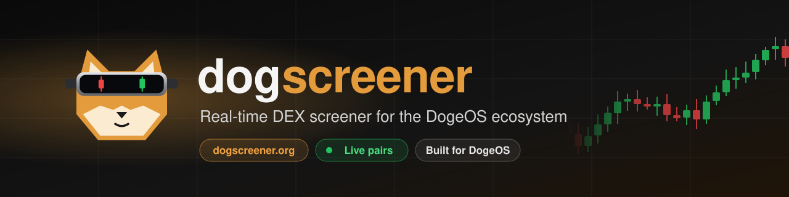

 

---

### 🐕 What is dogscreener?

**dogscreener** tracks every trading pair on DogeOS decentralized exchanges in real time: prices, charts, volume, liquidity and trades, in one fast and clean screener built only for DogeOS.

### ⚡ Features

| | |
| --- | --- |
| 📈 **Live pairs** | Trending, new, top gainers and top volume |
| 🕯️ **Candlestick charts** | 1m, 1h and 1d candles built from on-chain swaps |
| 🔎 **Pair pages** | Price change, buys and sells, makers, liquidity, FDV and recent trades |
| 🛡️ **Safety signals** | Low-liquidity alerts, locked or burned LP, warnings for tokens that impersonate DogeOS |
| 🔀 **Multi-DEX** | Uniswap V2 forks, Uniswap V3 and Algebra pools, more DEXes as the ecosystem grows |
| 🚀 **Token info and boosts** | Projects add their logo, socials and description, paid in DOGE |
| 🌗 **Light and dark themes** | On desktop and mobile |

### 🛠️ Built with

### 🗺️ Roadmap

- [x] DogeOS testnet indexer and screener
- [x] Token info, boosts and ads paid in DOGE
- [ ] DogeOS mainnet launch
- [ ] Price alerts and watchlist sync
- [ ] More chains

---

**Much screen. Very chart. Wow.** 🐾

[dogscreener.dog](https://dogscreener.dog) · [X](https://x.com/dogscreener_org) · [Telegram](https://t.me/dogscreener_org) · [Community](https://t.me/dogscreener_chat)

